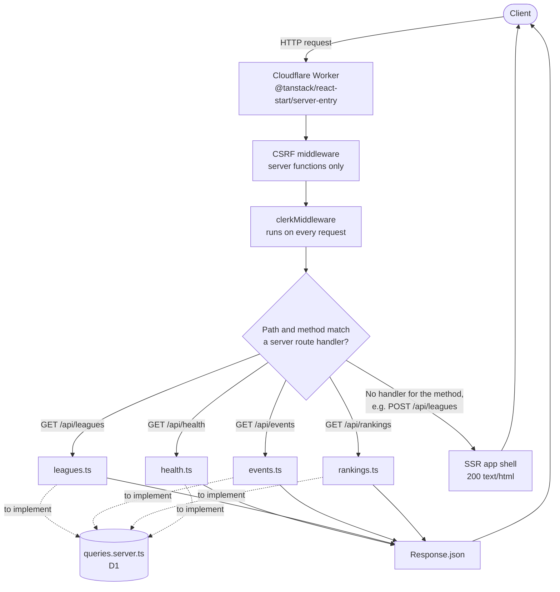

# API prototype review

Scope: the throwaway prototype on `feat/api`, built from `src/routes/api/api.md`.

Each route is one file in `src/routes/api/` (`health.ts`, `leagues.ts`, `events.ts` and `rankings.ts`), and each `GET` handler returns fixed JSON in the shape `api.md` documents. The routes don't read query parameters, call queries, or send CORS headers yet. This report lists what to handle when you add those.

**How it was tested:** under `vite dev`, with placeholder Clerk keys in `.dev.vars`. All four routes return `200` with their JSON.

## Request flow



## Findings

Ordered most important first.

| # | Area | Finding |
| --- | --- | --- |
| 1 | All routes | Clerk middleware runs on every API request. It needs Clerk keys and adds `x-clerk-auth-*` headers |
| 2 | All routes | Uncaught errors will return TanStack's default 500 body, not the documented error format |
| 3 | All routes | Unsupported methods such as `POST` return the HTML app with `200` |
| 4 | All routes | Vite's dev and preview servers answer `OPTIONS` themselves, so CORS preflight handlers only run in the built Worker |
| 5 | Rankings | `position` has to be the overall rank, not renumbered after filtering |
| 6 | Events | Weekly events can't be expanded without a month range, and `year` means 12 months |
| 7 | Events | Event rows include internal fields that `api.md` doesn't list |
| 8 | Rankings | Only the current season is stored |
| 9 | Rankings | `playerId` is the optional official ID: not unique, and the admin form saves `0` when it's missing |
| 10 | Events | What to do with conflicting date filters isn't defined |
| 11 | Events | `groupBy=league` keys are numeric strings, which JSON objects always sort numerically |
| 12 | Rankings | How `playerName` matches isn't defined |
| 13 | Design | Where `api.md` differs from the api-designer guidance |

## Details

### 1. Clerk middleware runs on public routes

`src/start.ts` registers `clerkMiddleware()` as global request middleware, so it runs before every server route (see the diagram).

- **Locally:** without `CLERK_SECRET_KEY`, every `/api/*` request fails with `Missing secretKey`, including `/api/health`.
- **In production:** each public request does Clerk auth work, and every response carries `x-clerk-auth-status` and `x-clerk-auth-reason` headers.

The CSRF middleware is already limited to server functions; Clerk is not. Skip Clerk for paths under `/api/` before anything else, either by wrapping it in a request middleware that checks `new URL(request.url).pathname`, or by limiting where it's registered.

### 2. Uncaught errors use the framework's format

When the routes start calling queries, anything that throws, such as a D1 error, comes back as:

```json
{"status":500,"statusText":"","unhandled":true,"message":"HTTPError"}
```

This is not the `internal_error` envelope `api.md` documents. Once CORS headers are added, this response won't carry them either, so a browser on another origin would see a CORS error instead of a 500. To return the documented error, catch around the query calls in each route.

### 3. Unsupported methods fall through to the app

A route only answers the methods it defines. `POST /api/leagues` falls through to SSR and returns the HTML app shell with `200 OK`. `HEAD` gets the same response as `GET`.

For a JSON API, unsupported methods should return `405 Method Not Allowed` with an `Allow` header. Add handlers for `POST`, `PUT`, `PATCH` and `DELETE` that return it.

### 4. Testing CORS preflight

`api.md` documents an `OPTIONS` handler that returns `204` on every route. Vite's `server.cors` and `preview.cors` middleware answers every `OPTIONS` request before it reaches the Worker. It replies `204` with `Access-Control-Allow-Methods: GET,HEAD,PUT,PATCH,POST,DELETE`, and a route's own `OPTIONS` handler never runs.

To test the real handlers, build the app and run it under Wrangler:

```sh
npm run build
npx wrangler dev -c dist/server/wrangler.json
```

Or set `server.cors: false` in `vite.config.ts` to see the real preflight in dev.

### 5. Ranking positions after filtering

`queryRankings` numbers rows by array index after the query has run. If the rankings query does the same after filtering by `playerId` or `playerName`, every matching player gets `position: 1`.

Work out each position over the whole season, for example with `ROW_NUMBER() OVER (ORDER BY cp DESC, name ASC)` in a subquery or in TypeScript, and filter afterwards. Keep the tiebreak the same as `queryRankings`: `cp DESC, name ASC`.

### 6. Expanding weekly events needs a month range

`expandRecurring` in `src/lib/recurrence.ts` works one month at a time, so the events query has to turn the filters into months:

| Filters | Months to expand |
| --- | --- |
| `day` | The month the day is in, then keep only that date |
| `month` | That month |
| `year` | All 12 months |
| None | No end date, so weekly events can't be expanded |

With no date filter you have to choose: return a `400` that asks for a date filter, use a default range, or return weekly events without expanding them. `api.md` currently says "lists events" with no limit.

Events have no pagination. A `year` request across every league could be large, which ties in with finding 13.

### 7. Internal fields in event responses

The existing event queries pass rows through `withoutNulls`, so every column with a value is returned. That includes three properties `api.md` doesn't list:

- `pokedataGuid`, which is internal
- `excludedDates`, which is always present because it defaults to `[]`
- `isExcluded`, which is always `false` because excluded occurrences are filtered out

Map rows to the documented `Event` properties before returning them. Check the serialized JSON, not only the TypeScript type: the types won't catch an extra property.

`withoutNulls` also leaves out empty optional properties entirely, which matches the note in `api.md`. The example JSON in `events.ts` follows this: the weekly occurrence has no `ticketLink`.

### 8. Seasons that aren't stored

`api.md` accepts any `YYYY` season, but the `players` table only holds the current season (#238). Decide whether another season returns `404 not_found` or `200` with an empty `rankings` list, then add that to `api.md`.

The response's `season` is a string (`"2027"`), because `currentSeason()` in `src/features/rankings/season.ts` returns a string. The example JSON matches this.

### 9. `playerId` is the official player ID

The `playerId` filter should match the `players.playerId` column, not the table's `id` primary key. That column:

- is optional
- isn't unique
- is stored as `0` when an admin leaves it blank (`NationalRankingsModal` sends `p.playerId ?? 0`, and `toInteger` in `admin.functions.ts` keeps it)

Reject `playerId=0` at the route so a player with no ID can't be matched by accident. Also decide what happens when two players share an ID.

### 10. Conflicting date filters

A request such as `?day=2026-11-21&month=2026-12` has filters that disagree. If the query combines them with AND, it returns an empty list. Choose whether this should be a `400` instead, then add the rule to `api.md`.

### 11. Group key order

With `groupBy=league`, the keys are league IDs such as `"1"` and `"2"`. JavaScript objects always order integer-like keys numerically, whatever order they were inserted in. Groups therefore come out ordered by league ID, not schedule order.

Day, month and year keys keep insertion order, so they follow the order the query returns. Keep that sorted with `sortEventsForSchedule`. If clients need a guaranteed order, return an array of `{ key, events }` instead of an object.

### 12. How `playerName` matches

`api.md` says "players whose name matches" but doesn't define:

- exact match or substring
- case sensitivity
- whether surrounding spaces are trimmed
- escaping `%` and `_` if the query uses `LIKE`

Document the choice in `api.md`.

### 13. Differences from the api-designer guidance

The api-designer skill asks for several things that `api.md` doesn't do:

- **Error format:** RFC 7807 problem details (`application/problem+json` with `type`, `title`, `status`, `detail`), where `api.md` uses `{ error: { code, message } }`.
- **Pagination:** on every collection endpoint. None here; see finding 6.
- **Versioning:** a versioning and deprecation strategy, such as `/api/v1`. The routes aren't versioned.
- **Rate limiting:** none. Cloudflare's rate limiting binding or a WAF rule could provide it.
- **OpenAPI:** an OpenAPI 3.1 spec. `api.md` is a plain Markdown reference.

None of these block the prototype. Decide on them before the routes become a public contract.

## Notes

- **Local setup:** the routes need `.dev.vars` with Clerk keys (see finding 1). `npm run typecheck` needs `npm run cf-typegen` first, so that `worker-configuration.d.ts` exists.
- **`api.md` location:** `src/routes/api/api.md` sits in the routes folder. The route generator ignores it, and `routeTree.gen.ts` has no entry for it.
- **Example JSON:** the values in each route are placeholders that follow the property tables in `api.md`. They aren't typed against `src/types/domain.ts`. `LeaderboardPosition` has no `playerId`, so the rankings example wouldn't match it.
- **Cache headers:** no route sends `Cache-Control`.
