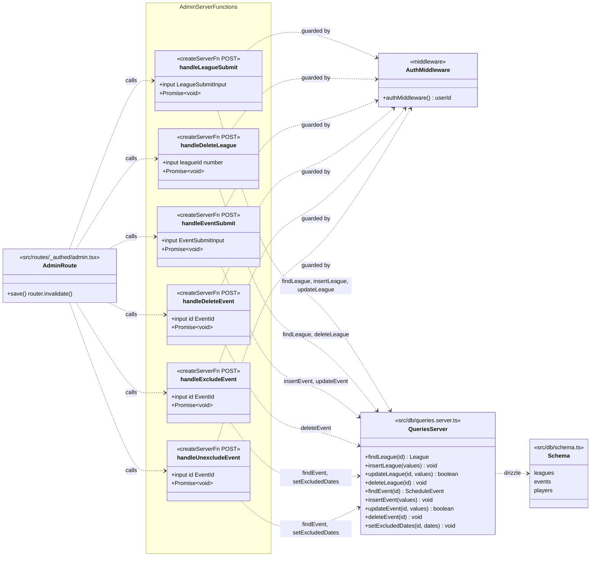
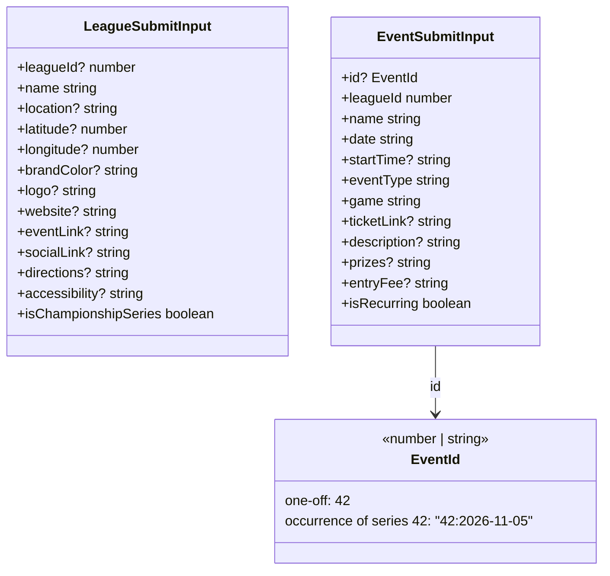

# Admin server functions

Write-side server functions for the admin dashboard, ported from
`deprecated/backend/app/routers/protected.py` and
`deprecated/backend/app/services/{league,event}.py`.

Every function is a `createServerFn({ method: "POST" })` guarded by
`authMiddleware`, and every write goes through `src/db/queries.server.ts`.
The route (`src/routes/_authed/admin.tsx`) calls `router.invalidate()` after
each save so the loader re-reads the schedule.

## Input types

## Behaviour (ported from the deprecated backend)

| Function | Legacy source | Behaviour |
| --- | --- | --- |
| `handleLeagueSubmit` | `create_league` / `patch_league` | No `leagueId`: insert. With `leagueId`: update, `not found` if the row is missing. |
| `handleDeleteLeague` | `delete_league` | `not found` if missing. Refuses championship series. Deletes the league's events, then the league, in one batch. |
| `handleEventSubmit` | `create_event` / `patch_event` | No `id`: insert (`isRecurring` picks one-off or series). With `id`: update the row. `isRecurring` and `excludedDates` are not changed on update. |
| `handleDeleteEvent` | `delete_event` | One-off id: delete the row. Occurrence id: delete the whole series. |
| `handleExcludeEvent` | `delete_event` with `excludeDate` | Occurrence id only. Adds the occurrence date to the series' `excludedDates`. Idempotent. |
| `handleUnexcludeEvent` | none in legacy | Occurrence id only. Removes the date from `excludedDates`. Added because the admin list exposes an "unexclude" action. |
